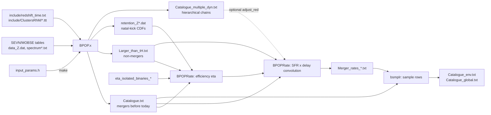

# How the B-POP code runs: a walkthrough

Reviewed on 2026-10-13 against the working tree at commit `447bbfd`, including uncommitted changes. This is a source review. No simulation, build or rate calculation was run to write it.

`BPOP_WORKFLOW.md` explains the physics and gives literature references. This report follows the **code**: what runs in what order, which files it reads and writes, how the stages hand data to each other, and where the implementation may not behave as the documentation says. Line references use `file:line`.

---

## 1. Overview

B-POP has two separate programs that communicate only through text files:

| Stage | Code | Input | Output |
|---|---|---|---|
| **1. Population synthesis** (C++) | `src/Main_Bpop_dev.cpp` (one ~3,400-line `main`) + `src/funcGR.cpp` (the `Functions` helper class) | Compile-time macros in `include/input_params.h`, precomputed SEVN/MOBSE stellar tables, the redshift–age table and cluster mass/radius tables | `Catalogue.txt`, `Larger_than_tH.txt`, `Catalogue_multiple_dyn.txt`, `retention_Z*.dat` and diagnostics, all moved into a `SIM_*` directory |
| **2. Cosmic rates and mock catalogues** (Python) | `utils/BPOP_MERGER_RATE/BPOPRate_v2025.py` + `utils/BPOP_LIBPY/lib_BPOPRate.py` | The stage-1 catalogues and an isolated-binary efficiency table | Efficiency tables, merger rate density per environment, mock event catalogues |



The C++ program produces **unweighted Monte Carlo coverage**. It draws formation epochs and metallicities with simple distributions. The default `"continuous"` setting draws formation redshift uniformly in 0–15. Cosmic weighting is applied only later, in Python, through the star-formation history ψ(z), the metallicity probability P(Z|z) and the efficiency η(Z). The C++ redshift and metallicity distributions are not physical rates.

---

## 2. Configure and build

- **All parameters are preprocessor macros** in `include/input_params.h`. Any change requires recompiling. Run `make` at the root, which calls `build/Makefile` (`-O3 -std=c++17 -I../include`) and produces `build/BPOP.x`.
- **Path macros:** `PREDIR` must point to the **repository root**. The code opens `PREDIR + "include/redshift_time.txt"` (`Main_Bpop_dev.cpp:328`) and `PREDIR + "include/ClustersRhM/scottrule_{radi,mass}{YC,GC,NC}.ttt"` (`:606`). `PATH` and `SINGPTH` are appended to `PREDIR` and must contain the stellar tables for each metallicity:
  - `data_<Z>.dat`: isolated BBHs, `kpar=20` columns. The code uses column 1–2 for BH masses, 3–4 for progenitor masses, 6 for delay [Myr], 7 for separation [R☉] and 8–9 for spins.
  - `spectrum<digits>.txt`: BHs from "divorced"/mixed binaries.
  - `spectrum_cleaned<digits>.txt`: single-star BHs. Both spectra have `spar=5` columns: ZAMS mass, remnant mass, (unused), BH formation time [Myr], natal kick [km/s]. `<digits>` is the metallicity with the leading `0.` removed, so 0.0002 becomes `0002`.
- The committed `PREDIR` is the upstream author's machine path. The Pop III variant generates paths automatically (section 9).

---

## 3. C++ stage, step by step

### 3.1 Startup (`Main_Bpop_dev.cpp:180–700`)

1. **Chunk offset.** If `CHUNKS=="yes"`, the code reads an integer from `chunk.out` and starts the source IDs at `chunk × N` (`:199`, `:989`). If the file is missing, it prints a message and exits with status 0.
2. **Optional isolated efficiency correction** (`MERGER_EFF_CORR=="yes"`) reads `utils/BPOP_MERGER_RATE/eta_isolated_binaries`. It is normally `"no"`.
3. **Redshift ↔ age table:** 10,000 rows from `include/redshift_time.txt`. The present age `Hubble = age[0]×1e9` yr is 13.787 Gyr.
4. **Spin labels:** `spinlb` sets the spin prescription for isolated binaries (`isospin`) and dynamical binaries (`dynaS`). `"mixed"` and `"mixedhigh"` split them.
5. **Metallicity grid:** `SEVN` selects the discrete grid of stellar tables (`met[]`) and the grid used for retention-file names (`metdyn[]`). `"yes"` and `"no"` give 12 values. `"iorio"` gives 15 and `"all"` gives 16.
6. **Cluster tables:** cumulative distributions of cluster mass and radius for YC, GC and NC.

### 3.2 Allocate candidates to channels (`:778`)

The code splits the sources by fixed fractions, with no random draw:

```
Niso = N(1−DynOvTot)   Nyc = N·DynOvTot·pYC   Ngc = N·DynOvTot·pGC   Nnc = remainder
```

The source index `i` encodes the channel: `[0,Niso)` isolated, then YC, GC, NC. The rest of the code relies on this ordering.

### 3.3 Formation times (`:789`)

`Functions::sfr_red()` (`funcGR.cpp:379`) draws a formation redshift, and the age table converts it to cosmic age `tfor[i]` [yr]:

| `SFRTYPE_*` | Draw |
|---|---|
| `continuous` / `grid` | z uniform in [0, 15] |
| `MF17` | Madau–Fragos shape, rejection-sampled for z < 20 |
| `EB18` | Gaussian at z = 3.2, σ = 1.5 |
| `KR13` | z uniform in [2, 10] |
| `bigbang` / `burst` / `single` | fixed z = 20 / 20 / 2 |

Isolated binaries and YCs use `SFRTYPE_ISO`. GCs and NCs use `SFRTYPE_CLU`. `EB18_MF17` assigns EB18 to GCs and MF17 to NCs.

### 3.4 Metallicities (`:808–990`)

Each source gets log Z from a redshift-dependent mean (`Functions::metcor`), with Gaussian scatter `sigma_metal_*` truncated to the grid range. Options:
- `bigbang`: log-uniform.
- `grid`: a random grid value.
- `single` / `MonoZ`: the fixed value `mono_Z`.

Values outside [0.9·Z_min, 1.2·Z_max] are clamped to the grid edges. `met_dist.txt` records the histogram.

### 3.5 Isolated binaries (`:1013–1270`)

- Each isolated source's Z is **snapped to the nearest grid metallicity** using midpoints between grid values.
- For each grid Z that has sources, the code loads `data_<Z>.dat` into memory. For each source it then:
  1. picks a **whole row uniformly at random**, which keeps the correlations between masses, spins, separation and delay;
  2. assigns spins: `giacobbo` uses the table values; `bavera` gives the first-born BH a low ("fuller") spin and the second a uniform spin; other options call `Functions::spin`;
  3. calls `Functions::SREM2` (NR fits) for the remnant mass, spin, χ_eff and GW recoil;
  4. computes `t_merge = tfor + delay`. If this is before today, it writes a row to `Catalogue.txt` with environment `none`. Otherwise it writes a row to `Larger_than_tH.txt`.

### 3.6 Dynamical binaries: setup for each metallicity (`:1305–1595`)

- Dynamical sources are grouped into `numZ` **equal-width bins in log Z** spanning the sampled range. Bin *k* uses the stellar tables of `met[k]`. This assignment differs from the isolated midpoint snapping (see issue C7).
- For each bin, the code loads both BH spectra into vectors. It then draws 1,000 BHs from each with no kick limit. From these it writes `retention_Z<Z>.dat`: velocity, CDF for single BHs, CDF for mixed BHs. Python later uses these files for natal-kick retention.

### 3.7 Dynamical binaries: each source (`:1595–2290`)

1. **Environment** from the index range (`young` / `globular` / `nuclear`). The code also sets a binary fraction `fb` = 0.4 / 0.1 / 0.01, which enters the encounter timescales.
2. **Spectrum choice:** `mixer = rnd()`. If `mixer > mixing`, BHs come from the *single* spectrum; otherwise from the *mixed* one. So `mixing` is the probability of the mixed (binary-origin) spectrum.
3. **Cluster:**
   - Mass is drawn from the cumulative-distribution table. Radius comes from the table divided by U(2, 20), or from a `TagR` recipe (`AS20` for NCs, `Marks12`, `Rantala24`, `Mapelli20`, `seed`).
   - The escape speed `vthre` comes from `Functions::vescape`. The cluster is redrawn until `vthre ≥ 2 km/s`, or `≥ 10 km/s` for single-spectrum draws at Z = 0.02 (`:1888`).
   - From these the code derives σ, ρ, t_relax and t_cc, and the BH reservoir `nbhs = 0.0008·M·f_ret·f_encl` (at least 2; `:1960`).
4. **BH pair:** the primary and secondary are drawn by rejection sampling until the natal kick is ≤ `vthre` (`singBHt_new` / `singBHt_mix`). Each draw returns remnant mass, formation time and kick. Spins come from `dynaS`.
5. **Optional extra massive BHs** (applied after the pair is drawn):
   - `uppergap=="yes"`: with a Z-dependent probability (`upgtp=="dicarlo"`), one or both components below `mass_gap` are replaced by power-law 50–100 M☉ BHs.
   - `bhseed` = `bifrost`, `vms`, `yes`, `density` or `seed`: replaces the primary with an IMBH seed when the cluster density and metallicity conditions hold.

### 3.8 First-merger clock (`:2291–2645`)

The variable `time` starts at `tfor[i]` and is advanced in stages. After each stage, the cluster is re-evolved: `mevol`, `revol` and `vevol` scale σ, ρ and v_esc according to `CLfill` (`GG23` by default).

```
time = tfor
     + max(t_DF, t_BHform)                      # sinking vs. BH formation (t_BHform = max(tpri, tsec))
     + min(t_capture, t_3bb)·N(1,0.1)           # binary formation (fbin = prob. of t_3bb = 0)
     + t_12·N(1,0.1)                            # pairing
     + 5(m1+m2)/m_per · t_bbh                   # hardening down to a_crit
     + t_GW(a_crit, e)                          # Peters inspiral, e = sqrt(U) (thermal)
```

- If a stage would cross core collapse (`tfor + tcc`), `time` is first set to the core-collapse moment and the stage is recomputed.
- **Classification:**
  - `a_crit = min(a_hard·N(1,σ_sma), max(a_ej, a_GW))`.
  - The binary is labelled `inside` if `a_ej < a_GW`, or if `a_crit < a_GW`. Otherwise it is `ejected`.
  - An `ejected` binary is relabelled `inside` if its Peters time is shorter than the hardening time.
- If the cluster mass falls below 10 M☉, every remaining stage is set to 10¹² yr, so the binary cannot merge.
- If `time > Hubble`, the code writes a row to `Larger_than_tH.txt` and records no merger.

### 3.9 Hierarchical chain (`:2646–3130`)

A loop runs while the remnant can merge again. Each pass:

1. **Checks termination**, in this order:
   - `time > Hubble`;
   - `highlander`: the *next* merger would happen after today. The code writes a non-merger row and stops;
   - `GWrecoiled`: the recoil exceeds the evolved v_esc;
   - `inevap`: the cluster evaporated, a flag set before the loop.
2. **Commits the time** of the merger just computed and **writes a row to `Catalogue_multiple_dyn.txt`**.
3. **Stops** if the primary exceeds `msmbhmax` (an SMBH formed), if `nrecy > nbhs` (the reservoir is used up) or if the label is `ejected`.
4. **Otherwise builds the next merger:**
   - The remnant becomes the primary. A new secondary is drawn with the kick limit set to the current v_esc.
   - The code computes a new t_DF. It scales with the radius the recoiled remnant reaches, `r_∞` (`:2904`).
   - It then computes t_12, hardening and Peters times, and the label (`dissolved`, `inside` or `ejected`).
   - `SREM2` gives the new remnant, and `nrecy` is incremented.

After the loop, if `time < Hubble`, **one summary row per source** goes to `Catalogue.txt` (`:3136`). It contains the last pair, the final remnant, the label and the absolute time `time`.

### 3.10 Finishing up (`:3190–3365`)

- The code builds a histogram from any `Catalogue<i>.txt` files left over from older workflows.
- It builds a directory name `SIM_Fdyn…_SFR_…` from the main parameters and runs **`mv *.txt *.dat SIM_…`** through `system()` (`:3355`). This moves **every** `.txt` and `.dat` file in the working directory, including input files. Always run the program in an empty run directory.
- It prints the realised merger counts per channel and `Elapsed time = …`. The Pop III `make run` target uses that line as its completion marker.

---

## 4. C++ output files

| File | Rows | Points to watch |
|---|---|---|
| `Catalogue.txt` | Isolated mergers before today, plus one terminal summary per dynamical source that merged before today. 36 columns; header in `:1013`. | Column 14 `tlast_mer` is the **absolute cosmic age** at merger, not a delay. Column 18 is the status label. The metallicity column holds the snapped grid value for isolated rows but the continuous `Z[i]` for dynamical rows. |
| `Larger_than_tH.txt` | Non-mergers: isolated binaries with delay > today, dynamical first mergers after today, `highlander` chain ends. 25 columns. | Columns 11 and 23 mean different things for isolated rows (delay) and dynamical rows (absolute time). Column 24 is `tfor` in both. Dissolved clusters can produce infinite separations. |
| `Catalogue_multiple_dyn.txt` | One row per completed in-cluster merger step. | The standard writer emits 32 fields (`struct_CatMul.md` says 33). Times are in yr. The merger that ends a chain by GW recoil is **not** written here (it is written in `Catalogue.txt`). |
| `retention_Z<Z>.dat` | 50 velocities × (single CDF, mixed CDF). | Used for natal-kick retention in Python. |
| `Catalogue_clean.txt`, `dynsrc_vescape.txt`, `met_dist.txt` | Diagnostics. | `Catalogue_clean.txt` is reopened without append (`:1277`), so the isolated rows are overwritten. |

### Chunked runs

- `tools/bpop_chunks.sh` creates `chnk0…chnk{N-1}`, writes `chunk.out` and starts one background `BPOP.x` per directory. It does not wait for them to finish.
- Each chunk simulates `N` sources, with IDs offset by `chunk × N`. Once all chunks have finished, `tools/bpop_catcatalogues.sh` concatenates the three main catalogues. The `#` header lines remain and `np.loadtxt` skips them.
- `retention_Z*.dat` is not collected. Copy one chunk's set by hand.

---

## 5. Python stage: `BPOPRate_v2025.py`

### 5.1 Setup

- **Configuration is module-level variables** (`:51–80`):
  - `IDmod`, which also sets `fmix = IDmod/4`;
  - the SFR model letter `a`;
  - `IBfrac`, `fysc_mw`, `f_NCoc`, `f_GCsc`, `Tobs`, `maxz`, `massive`, `repetita`, `evapora`, `adjust_red`, `pre`.
- **Hard-coded upstream paths:** the library import (`:22`) and `redshift_time.txt` (`:338`). These must be edited before running. Catalogues are read from `name_file="../"`, and `eta_isolated_binaries_SEVN` is read from the current directory (`:228`).
- **Normalisations:** `fbh=0.0026` BH per M☉, `mstar=1`, binary fractions `fbin = [NC 0.2, GC 0.2, YC 0.6, iso 1.0]`. These Python fractions are separate from the C++ `fb` and `fbin`.

### 5.2 Star-formation histories (`:262–330`; `lib.models`, `psi`, `msca`)

- Model `a` uses MF17 for NC, YC and isolated binaries, and an EB19 Gaussian for GCs, each with its own normalisation.
- YC and isolated SFRs are the MF17 total scaled by `fysc_mw` and `IBfrac`. Each is capped so the sum of all channels cannot exceed the total.
- Planck18 replaces the ages in the redshift table.

### 5.3 Efficiency η(Z, environment) (`:487–570`)

- **Isolated:** `η = IBcorr × eta_isolated_binaries(Z)`, with `IBcorr` = 0.185 for SEVN.
- **Dynamical:** for each grid Z (midpoint bins) and environment:

  ```
  η = fbh/mstar · (N_merge [+ N_repeat]) / (N_merge + N_nonmerge) · fbin_env · <f_ret>_M
  ```

  - `N_nonmerge` counts `Larger_than_tH` rows with `nrecy==0`.
  - `<f_ret>_M` is the natal-kick retention at each merger's initial-cluster escape speed, weighted by cluster mass: `(1−fmix)·CDF_single + fmix·CDF_mixed`, read from `retention_Z*.dat`.

### 5.4 Rate convolution (`:588–810`)

For each merger-time bin *i* (499 bins over z = 0–15) and metallicity *k*, the code integrates over formation bins *j* (500 points from z_i to 15) with Simpson's rule:

```
I_j = ψ_env(z_j) · η_env,k · [dN_ij / N_j] · P(Z_k | z_j) · |dt/dz| · 1e9 / Δt_i
```

- `N_j` counts mergers plus non-mergers formed in bin *j*.
- `dN_ij` counts mergers formed in bin *j* whose absolute merger time falls in bin *i*.
- `P(Z_k|z)` is the probability mass of a lognormal in log Z across bin *k*.

The code writes `Merger_rates_a_<env>_massive_no.txt`: z, total, then one column per metallicity. If that file already exists, the code skips the environment.

With `adjust_red="yes"`, the code moves each hierarchical source's merger epoch and masses to a chosen chain step (median time, last step, …) read from `Catalogue_multiple_dyn.txt`.

### 5.5 Mock catalogues (`lib.bsmplr`, `lib_BPOPRate.py:404`)

1. Each catalogue Z is jittered uniformly within its grid bin.
2. Per environment, the rate per metallicity is smoothed with `make_smoothing_spline` and negative values are set to zero.
3. The expected count in each redshift shell is `N = R · ΔV_c · Tobs/(1+z)` (`Nsam`).
4. In each (Z, z) bin the code draws rows from `Catalogue.txt` **with replacement**:
   - an expected count below 1 becomes a Bernoulli draw;
   - a count of 1 or more is **truncated** by `int()` (`:603`).
5. Output: `Catalogue_<env>.txt` and `Catalogue_global.txt`, 22 columns. All `*.txt` files in the working directory are moved to `SMPCAT_Massive_<massive>/` and then into `SET<IDmod>a_IB…_Tobs…/`.

No detector selection is applied. These are cosmic (intrinsic) samples.

---

## 6. Data passed from C++ to Python

| Python quantity | Source file and column (0-based) | Remarks |
|---|---|---|
| Merger z, formation z | `Catalogue.txt` 24, 25 | |
| Metallicity, environment | `Catalogue.txt` 1, 3 | |
| Absolute merger time | `Catalogue.txt` 14 | Used to place mergers in time bins |
| Cluster mass, radius → v_esc | `Catalogue.txt` 15, 16 | Initial values (t = 0) |
| Number of repeats, status | `Catalogue.txt` 2, 18 | |
| Non-merger Z, environment, nrecy | `Larger_than_tH.txt` 13, 14, 22 | |
| Non-merger "formation" time | `Larger_than_tH.txt` **23** in the production script | Column 23 is the end time, not `tfor` (see issue P1) |
| Natal retention | `retention_Z<Z>.dat` | `fmix` must match the C++ `mixing` (see issue P2) |

---

## 7. Running the standard pipeline end to end

1. Set `PREDIR`, `PATH`, `SINGPTH` and the science parameters in `include/input_params.h`. Run `make clean && make`.
2. Create an empty run directory. Copy `build/BPOP.x` and the parameter header into it. For chunked runs also copy `tools/*.sh`, set the chunk count `N` in the script and keep `CHUNKS "yes"`. For a single run either set `CHUNKS "no"` or create `chunk.out` containing `0`.
3. Run `./BPOP.x > Output.txt`, or `sh bpop_chunks.sh` and then, once **every** chunk has finished, `sh bpop_catcatalogues.sh`. For chunked runs, copy one set of `retention_Z*.dat` next to the merged catalogues.
4. Copy `utils/BPOP_MERGER_RATE/` into the run directory so that `../` contains the catalogues. Fix the hard-coded paths, choose `IDmod`/`fmix` to match `mixing`, and run `python BPOPRate_v2025.py`.

---

## 8. Issues found during this review

The **new** items were found by reading the source for this report and are not listed in `HANDOFF.md`. The **known** items were already recorded there. None has been fixed. Line numbers refer to the standard driver; the Pop III copy shares most of these issues.

### C++ simulator

| # | Severity | Location | Issue |
|---|---|---|---|
| C1 (new) | **High** | `Main_Bpop_dev.cpp:1656`, `:2503`, `:2900` | `mu_red` is declared without a value and first assigned inside the hierarchical loop (`:2900`). The **first** merger's ejection separation `semi_ej` (`:2503`) therefore reads an uninitialised variable, which is undefined behaviour. `semi_ej` sets `a_crit`, the `inside`/`ejected` label and the Peters time, so it affects every first-generation dynamical merger. The same bug is in `Main_Bpop_dev_p3.cpp:2584`. Fix: compute `mu_red = mpri*msec/(mpri+msec)` before `:2503`. |
| C2 (new) | Medium | `:407`, `:425/457`, `:500/532` | With `SEVN="yes"` or `"no"`, `nmetal=12` but the code writes `met[12]` and `metdyn[12]` (value 0.03). This is a heap write past the end of the array. In the `iorio` and `all` branches of the `metdyn` block, the code writes to `met[]` instead of `metdyn[]`, so `metdyn` (used for retention-file names) is left uninitialised. |
| C3 (new) | Medium | `:1245` | Isolated non-merger rows write `Z[i]`, where `i` counts sources *within the metallicity group*, not the source index `arr[k][i]`. The metallicity in those `Larger_than_tH.txt` rows can therefore belong to a different source. |
| C4 (new) | Medium | `:2700–2730`, `:3136` | When a chain ends as `highlander`, `mpri`, `msec` and the remnant (`Mrem[i]` …) have already been updated to the **next, unrealised** merger. The `Catalogue.txt` row then pairs those masses with the time of the previous, completed merger. |
| C5 (new) | Low | `:2282` | After the IMBH-seed and upper-gap branches, `apri` is reassigned from `dynaS`. This overwrites the random spins assigned to seeds and gap BHs. The Pop III header comment already says the seed spin "is overwritten". |
| C6 (new) | Low | `:2737` | A merger that ends a chain by GW recoil is written to `Catalogue.txt` but not to `Catalogue_multiple_dyn.txt`, because the chain row is written after the recoil check. Growth histories reconstructed from the chain file therefore miss their last step. |
| C7 (new) | Low | `:1306–1340` vs. Python `Zedge` | Dynamical sources choose stellar tables by equal-width log-Z bins, while Python groups them by midpoints between grid values. Near bin edges, a source simulated with the `met[k]` tables can be counted in bin `k±1`. |
| C8 (known) | Medium | `Main_Bpop_dev.cpp:42`, `funcGR.cpp:1105`, `funcGR.cpp:605` | The kick-limited samplers loop forever if no BH in the spectrum has a kick ≤ v_esc. `rnd()` creates and seeds a new `mt19937` from `random_device` on every call, which is slow and makes runs impossible to reproduce. |
| C9 (known) | — | `:3355` | `mv *.txt *.dat` moves inputs out of the working directory. Run only in a dedicated directory. |

The Pop III driver includes December 2025 fixes that the standard driver lacks: the core-collapse shortcut is now blocked before the BHs have formed (`tSNe < tcc`), and the BH reservoir can be depleted as the cluster evolves.

### Python rate stage (production script)

| # | Severity | Location | Issue |
|---|---|---|---|
| P1 (known, fixed only in the Pop III copy) | **High** | `BPOPRate_v2025.py:371`, `:483` | The script bins non-mergers by the redshift of column 23, which is the **end time**, not `tfor` (column 24). For dynamical non-mergers this time is later than today, so `interp` extrapolates to *negative* redshift and these rows never enter the denominator `N_j`. For isolated rows, column 23 is the delay time, which gives a meaningless redshift. `BPOPRate_v2025_p3.py:538` uses column 24. |
| P2 (new) | Medium | `:51`, `:100–106` | `fmix = IDmod/4` sets the single/mixed retention weighting independently of the C++ `mixing` macro. The defaults disagree: C++ `mixing=1.0` means every BH is drawn from the mixed spectrum, while `IDmod=2` gives `fmix=0.5`. Keep them consistent by hand. |
| P3 (new) | Low | `lib_BPOPRate.py:603` | Expected counts ≥ 1 are truncated (`int(2.9)=2`) rather than drawn stochastically. Only counts below 1 are drawn at random. This undercounts sampled events, on top of the bins skipped because no catalogue row matches. |
| P4 (known) | Review | `:565` and `:775` | Non-mergers appear in both η, through the merger fraction, and in `dN/N`. The combined normalisation needs scientific review before absolute rates can be trusted. |
| P5 (known) | — | `:22`, `:338` | Hard-coded absolute paths to the upstream author's machine. |

---

## 9. Population III variant (`tests/pop3_compile_test/`)

The variant is a separate copy, not a set of switches in the shared code. Its own `Main_Bpop_dev_p3.cpp` and `input_params_p3.h` are compiled against the **shared** `src/funcGR.cpp`, so any change to `funcGR.cpp` affects both drivers.

Differences from the standard driver:
- `SEVN="pop3"`: a single metallicity, Z = 10⁻¹¹. The stellar tables are `data_1e-11.dat` (one header line), `spectrum1e-11.txt` and `spectrum_cleaned00000000001.txt`, all inside the test directory.
- Input loading validates every row with `read_numeric_record`, rejects non-finite values and empty files, and drops the truncated last row of the mixed spectrum.
- Paths come from a generated `.build/build_paths.h`. `make run` checks the inputs, runs in a fresh `tmp/pop3-run.XXXXXX/` and confirms completion.
- Default settings: `N=1000`, `mixing=0.5`, `spinlb="fuller"`, no upper-gap BHs or seeds, wider metallicity scatter.
- The dynamical-physics fixes listed after the C++ issue table. The chain file gains an extra `nbhs` column.
- The Python pair (`*_p3.py`) adds a CLI (`--catalogue-dir`, `--smoke-test`, grid sizes, `--seed`, `--rates-only`) and records the inputs of each run. Its fixes include P1. `--smoke-test` borrows the generic model-`a` star-formation histories and switches off the isolated channel. Its results show that the code runs; they are not calibrated Pop III rates.

`tests/pop3_compile_test/README.md` and `HANDOFF.md` give the commands and the retained runs.
