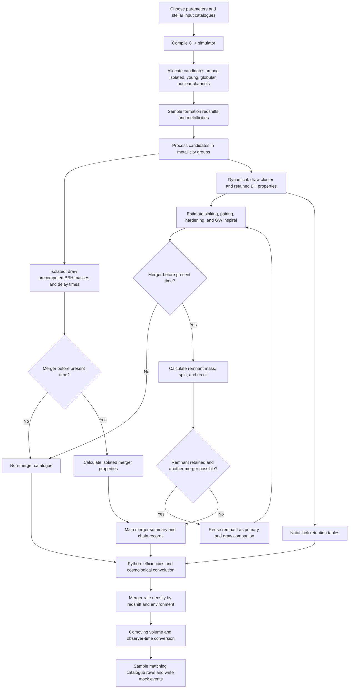

# B-POP workflow: implementation, physical reasoning, and literature

Reviewed on 2026-10-12 against the local working tree based on commit `447bbfd`, including uncommitted changes. This report describes the standard C++/Python workflow and then the experimental Population III variant. It is a source review, not a new simulation or a validation of predicted rates.

## 1. What B-POP calculates

B-POP constructs binary black hole (BBH) populations through isolated binary evolution and dynamical assembly in young, globular, and nuclear star clusters. Its architecture combines precomputed stellar-evolution catalogues, Monte Carlo sampling, analytic estimates of dynamical timescales, and numerical-relativity fits for merger remnants. The original methods paper explains this semi-analytic approach and its formation channels: [Arca Sedda et al. (2023)](https://academic.oup.com/mnras/article/520/4/5259/7009215).

There are two computational stages:

1. **C++ population construction:** generate candidate binaries, evolve their clocks and host clusters, calculate merger properties, and follow possible repeated mergers.
2. **Python cosmological weighting:** combine those catalogues with stellar formation histories, metallicity probabilities, and merger efficiencies to calculate merger rate densities and draw mock cosmic event catalogues.

The newer B-POP description explicitly includes SEVN inputs and a dedicated Python rate/catalogue stage: [Arca Sedda et al. (2026), especially Appendix A](https://arxiv.org/html/2603.20430v1). Published model settings are examples; the local parameter header and active branches determine this checkout's behavior.

## 2. Overall data flow

The diagram shows the logical dependencies. In the implementation, some remnant quantities are evaluated before the merger clock is finalized and cluster properties are updated repeatedly between clock advances.

## 3. Configure and compile

The main driver is [src/Main_Bpop_dev.cpp](src/Main_Bpop_dev.cpp); physics and sampling helpers are in [src/funcGR.cpp](src/funcGR.cpp), declared in [include/funcGR.h](include/funcGR.h). Settings are compiled from [include/input_params.h](include/input_params.h).

| Parameter group | What it controls | Why it matters |
|---|---|---|
| `PREDIR`, `PATH`, `SINGPTH`, `SEVN` | Locations and choice of stellar input catalogues | Fixes the upstream stellar and binary physics available to sample |
| `N`, `DynOvTot`, `pYC`, `pGC`, `pNC` | Candidate count and allocation among channels | Sets numerical sampling coverage |
| `SFRTYPE_ISO`, `SFRTYPE_CLU`, metallicity settings | Formation epochs and chemical composition | Connects stellar properties and available evolution time to cosmic history |
| `mixing`, `fbin`, `TagR`, `CLfill` | BH reservoirs, binary formation choices, cluster structure/evolution | Changes encounter rates, escape speeds, and merger delays |
| `spinlb`, `INDEX_ALIGN` | Natal spins and isolated spin alignment | Changes effective spins, remnants, and recoil retention |
| `uppergap`, `upgtp`, `bhseed` | Additional massive BH and seed prescriptions | Adds pathways beyond the ordinary stellar-remnant spectrum |

The local standard defaults include `N=1000000`, `DynOvTot=0.9`, `pYC=0.75`, `pGC=0.15`, `pNC=0.1`, `SEVN="yes"`, `mixing=1.0`, and `CLfill="GG23"`. These are configuration choices, not inferred cosmic channel fractions.

The root [Makefile](Makefile) delegates to [build/Makefile](build/Makefile) and produces `build/BPOP.x` with C++17. Changing the parameter header requires recompilation. Archive the header with each run so that the catalogue can be interpreted later.

**Why use precomputed stellar catalogues?** Stellar winds, mass transfer, common-envelope evolution, supernovae, and pair instability are already treated by the upstream population-synthesis calculation. B-POP can explore populations and environments without rerunning that expensive calculation for every candidate. Relevant upstream methods are [Iorio et al. (2023), SEVN](https://arxiv.org/abs/2211.11774) and [Giacobbo, Mapelli & Spera (2018), MOBSE](https://arxiv.org/abs/1711.03556). Input catalogues carry their assumptions; choosing a filename does not independently calibrate those assumptions.

## 4. Allocate channels, formation times, and metallicities

### 4.1 Allocate candidate counts

The active standard code uses deterministic allocation, approximately

$$
N_{\rm iso}=N(1-f_{\rm dyn}),\qquad
N_{\rm YC}=Nf_{\rm dyn}p_{\rm YC},\qquad
N_{\rm GC}=Nf_{\rm dyn}p_{\rm GC}.
$$

Integer conversion truncates these counts, and the nuclear count is the remainder. The older random channel-allocation loop is commented out. Thus the fractions determine how many candidates are attempted; subsequent failures and repeated mergers change the output counts. Source: `Main_Bpop_dev.cpp`, around lines 755–787.

### 4.2 Draw a formation epoch

`Functions::sfr_red()` samples a formation redshift. The driver converts it into cosmic age using `include/redshift_time.txt`; the present-age limit is taken from that table. Isolated binaries and young clusters share the first formation-time loop; globular and nuclear clusters use their selected cluster histories.

The available choices include a Madau–Fragos-shaped history, a Gaussian cluster history, fixed epochs, and broad sampling modes. In particular, the local defaults `"continuous"` draw **uniformly in redshift between 0 and 15**, rather than uniformly in cosmic time. Source: `Main_Bpop_dev.cpp`, around lines 789–806; `funcGR.cpp`, `sfr_red()` at line 379.

The physical motivation is that progenitor formation must precede merger. A stellar formation history supplies the available stellar mass at each epoch. A commonly used empirical history is

$$
\psi(z)=\frac{0.01(1+z)^{2.6}}{1+[(1+z)/3.2]^{6.2}}
\quad M_\odot\,\mathrm{yr}^{-1}\,\mathrm{Mpc}^{-3}.
$$

See [Madau & Fragos (2017)](https://arxiv.org/abs/1606.07887). Globular-cluster formation can follow a different history from the field; [El-Badry et al. (2019)](https://arxiv.org/abs/1805.03652) provides relevant cosmological cluster-formation context. B-POP's Gaussian recipes are simplified representations, not a rerun of that galaxy-assembly model.

### 4.3 Assign metallicity and group the work

The driver samples metallicity using redshift-dependent mean prescriptions and a scatter in logarithmic metallicity, with special modes for fixed or broadly sampled metallicity. It organizes candidates into metallicity groups to use the available discrete stellar tables. Source: `Main_Bpop_dev.cpp`, around lines 808–990; `funcGR.cpp`, `metcor()` at line 92.

Metallicity affects wind mass loss, remnant masses, and binary merger efficiency; a merger's masses therefore depend on the chemical conditions at progenitor formation. The strong metallicity sensitivity is demonstrated in [Giacobbo et al. (2018)](https://arxiv.org/abs/1711.03556).

Grouping candidates also reduces repeated loading of large input catalogues. The sampled formation distribution is numerical coverage for later weighting; it should not automatically be interpreted as a physical merger-rate distribution.

## 5. Isolated binaries: retain the upstream binary-evolution correlations

For each relevant metallicity, the driver reads a `data_<Z>...dat` catalogue and samples a complete binary record. It obtains the component masses, progenitor information, orbital separation, and delay time together, then assigns spins according to the chosen prescription. Source: `Main_Bpop_dev.cpp`, around lines 1086–1245.

The merger clock is

$$
t_{\rm merge}=t_{\rm formation}+\Delta t_{\rm input}.
$$

If this age precedes the present-age limit, the driver writes a merger; otherwise it writes a non-merger record. The imported delay already describes evolution from progenitor formation to coalescence. Adding cluster sinking and encounter times would change the formation channel.

Sampling an entire binary preserves correlations created by stellar evolution. For example, masses and orbital tightening are linked through mass transfer and common-envelope evolution; drawing both BH masses independently would discard those relationships. [Iorio et al. (2023)](https://arxiv.org/abs/2211.11774) explains the relevant SEVN binary physics and its uncertainties.

## 6. Dynamical binaries: construct a cluster-dependent merger clock

### 6.1 Draw the host cluster and BH reservoir

The dynamical branch samples cluster masses and radii from tables or selected mass–radius prescriptions, then estimates density, velocity dispersion, relaxation/core-collapse times, and escape speed. It selects BHs from single-star or mixed binary-origin spectra according to `mixing`, requiring acceptable natal kicks relative to the cluster escape speed. Source: `Main_Bpop_dev.cpp`, around lines 1306–2175.

Natal kicks are velocities imparted when compact objects form. A cluster can supply a BH for later encounters only if it retains that BH. Consequently, the available BH population depends on both stellar evolution and cluster potential depth.

The driver also writes natal-kick cumulative distributions in `retention_Z<Z>.dat`, separately for single and mixed origins. These tables permit Python to estimate how much of the underlying BH population survives a chosen velocity threshold.

Optional upper-gap and IMBH-seed recipes replace or supplement ordinary stellar BH sampling. Their purpose is to represent stellar collisions/mergers and massive-seed formation without resolving each collision. Relevant studies include [Di Carlo et al. (2021)](https://arxiv.org/abs/2105.01085) and [Arca Sedda et al. (2024), DRAGON-II III](https://academic.oup.com/mnras/article/528/3/5140/7513782). Their simulation results motivate such recipes; the local switches and coefficients still require inspection for a particular run.

### 6.2 Advance through the physical bottlenecks

The driver estimates the time for BHs to exist and reach the dense region, form a binary, pair/harden through encounters, and inspiral through GW emission. A schematic first-merger clock is

$$
\Delta t_{\rm dyn}\approx
\max(t_{\rm BH\ birth},t_{\rm sink})
+\min(t_{\rm binary-single},t_{\rm three-body})
+t_{\rm pairing}+t_{\rm shrink}+t_{\rm GW}.
$$

This expresses the code's sequencing rather than an exact universal formula. Birth and sinking use a maximum because they need not occur serially; alternative binary-formation routes use the shorter available timescale. Source: `Main_Bpop_dev.cpp`, around lines 2300–2630. [Antonini & Rasio (2016)](https://arxiv.org/abs/1606.04889) is explicitly cited in the source for the encounter-timescale framework.

The motivation is computational: estimate the rates of the important processes rather than integrate all stellar orbits and every few-body encounter. Density and velocity dispersion determine how often encounters occur; interactions can extract orbital energy from a hard binary until it becomes tight enough for GW emission to dominate.

### 6.3 Determine ejection versus an in-cluster merger

The code calculates an ejection separation `semi_ej` and a GW-dominated separation `semi_gw`. As the binary shrinks, the larger threshold is encountered first. Ejection can remove the binary before GW-driven decoupling; otherwise it can merge within the cluster. The implementation also compares the eccentricity-dependent inspiral time with an encounter/ejection timescale and can revise an initially ejected classification. Source: `Main_Bpop_dev.cpp`, around lines 2480–2605.

The dynamical eccentricity draw `ecc=sqrt(U)`, for uniform $U$, gives the thermal distribution $p(e)=2e$. The C++ driver uses the following Peters-based approximation:

$$
t_{\rm GW}\approx
\frac{5c^5a^4}{256G^3m_1m_2(m_1+m_2)}
\frac{(1-e^2)^{7/2}}{1+73e^2/24+37e^4/96}.
$$

Masses and separation must be converted to consistent units; the driver converts solar masses and AU and reports time in years. The circular limit has the familiar $a^4$ dependence, while eccentricity strongly shortens inspiral. This is an approximate lifetime prescription, not numerical integration of the complete eccentric evolution. See [Peters (1964)](https://journals.aps.org/pr/abstract/10.1103/PhysRev.136.B1224).

### 6.4 Update the cluster between events

Cluster evolution changes the next encounter and retention calculation. The driver repeatedly updates its mass/radius factors and uses scalings of the form

$$
\sigma\propto\sqrt{M/R},\qquad \rho\propto M/R^3,
\qquad v_{\rm esc}\propto\sqrt{M/R}.
$$

Core corrections (`mevol`, `revol`) and half-mass evolution (`mhalf_evo`, `rhalf_evo`, `vevol`) are separate helper functions. The `GG23` branch uses locally parameterized evolution informed by cluster lifetimes; it is not a literal implementation of every equation in [Gieles & Gnedin (2023)](https://arxiv.org/abs/2303.03791). Source: `funcGR.cpp`, lines 227–325 and 695–793.

Mass loss or expansion can slow encounters and reduce retention. This feedback is particularly relevant for repeated growth: a cluster that retained an early remnant may fail to retain a later one.

## 7. Spins, remnants, and the hierarchical-merger loop

`Functions::SREM2()` calculates remnant mass, spin, effective spin, and GW recoil from component masses, spin magnitudes, and sampled angles. Effective spin is

$$
\chi_{\rm eff}=\frac{m_1\chi_1\cos\theta_1+m_2\chi_2\cos\theta_2}{m_1+m_2}.
$$

The standard dynamical branch samples angle cosines using its `"dynamical"` mode. The isolated branch uses the alignment-index prescription. Natal spin options are phenomenological: for example, `"fuller"` sets a constant spin of `0.001`, and the isolated `"bavera"` branch combines a low-spin BH with a uniform spin draw assigned using progenitor ordering. These labels indicate simplified models. [Fuller & Ma (2019)](https://arxiv.org/abs/1907.03714) motivates efficient angular-momentum transport and low natal spin; [Bavera et al. (2020)](https://arxiv.org/abs/1906.12257) motivates differing first/second-born spins and tidal spin-up. The local implementation does not reproduce their full stellar-spin calculations.

The remnant helpers use UIB fits with local angle handling and fallback logic. Numerical-relativity fits provide fast estimates of final mass and spin without solving Einstein's equations for every simulated merger: [Jiménez-Forteza et al. (2017)](https://arxiv.org/abs/1611.00332). Recoil fits represent the momentum carried away by asymmetric GW emission: [Lousto & Zlochower (2008)](https://arxiv.org/abs/0708.4048), with further physical context in [Lousto & Zlochower (2011)](https://arxiv.org/abs/1108.2009). Source: `funcGR.cpp`, `SREM2()` at line 1649 and `kicks()` at line 1826.

After a dynamical merger, the driver compares GW recoil with the **evolved** escape speed. If retained, the remnant's mass and spin become the next primary; another companion is sampled, and a new delay is accumulated. The chain ends when the binary/remnant escapes, the cluster dissolves, the time limit or BH supply is exhausted, or a configured mass threshold stops growth. Source: `Main_Bpop_dev.cpp`, around lines 2660–3110.

Natal-kick retention and GW-recoil retention serve different purposes: the first builds the initial BH reservoir, while the second decides whether a merger remnant can contribute to the next generation. Repeated mergers can build objects beyond the ordinary stellar-remnant masses, but this growth depends on the retention and timing assumptions.

## 8. Catalogue outputs and their meaning

| Output | Contents and role |
|---|---|
| `Catalogue.txt` | 36 columns describing isolated mergers and the selected terminal dynamical-chain outcome; input for rate calculation and sampling |
| `Catalogue_multiple_dyn.txt` | Intermediate dynamical-chain records, used to inspect growth histories and optionally adjust the representative merger epoch |
| `Larger_than_tH.txt` | 25-column records of unsuccessful or unfinished merger candidates; needed for efficiency denominators |
| `retention_Z<Z>.dat` | Three columns: velocity and natal-kick cumulative fractions for single and mixed origins |

The schema guides are [struct_Catalogue.md](struct_Catalogue.md), [struct_CatMul.md](struct_CatMul.md), [struct_LargtH.md](struct_LargtH.md), and [struct_retZ.md](struct_retZ.md). Read them alongside the writers:

- The main dynamical catalogue is written after the chain loop (`Main_Bpop_dev.cpp`, around line 3136). It is not an event-complete listing of all intermediate mergers. A chain that ultimately runs past the time limit also needs examination in the chain/non-merger outputs.
- Main column 15, `tlast_mer`, contains the absolute cosmic merger age in the current writer, despite being called a delay time in the schema. Subtract column 14, `tfor`, to obtain the elapsed time since formation.
- `struct_CatMul.md` documents 33 columns, but the standard root writer around line 2795 emits 32 fields, ending with eccentricity. The Pop III variant adds the BH-count field. The chain writer also emits time variables directly in years where its schema says Myr.
- Environment strings written by the standard driver are `none`, `young`, `globular`, and `nuclear`; some schema descriptions use `YC`, `GC`, and `NC` shorthand.

Non-mergers matter scientifically: keeping only successful mergers removes the information needed to estimate how often a candidate fails to merge.

## 9. Python: turn sampled histories into cosmic rates

The standard driver is [utils/BPOP_MERGER_RATE/BPOPRate_v2025.py](utils/BPOP_MERGER_RATE/BPOPRate_v2025.py), supported by [utils/BPOP_LIBPY/lib_BPOPRate.py](utils/BPOP_LIBPY/lib_BPOPRate.py). Its settings define channel formation histories and normalizations, metallicity models, filters, and observation time. `models()`, `psi()`, `metcor()`, and `msca()` assemble these inputs; Planck18 supplies cosmological ages and volumes.

### 9.1 Calculate metallicity-dependent efficiency

Efficiency $\eta_c(Z)$ has units of mergers per solar mass of formed stars. The isolated channel reads an external `eta_isolated_binaries...` table and applies its configured correction.

For dynamical channels, the implemented estimate is approximately

$$
\eta_c(Z)=\frac{f_{\rm BH}}{\bar m_\star}
\frac{N_{\rm merge}+N_{\rm repeat}}{N_{\rm merge}+N_{\rm nonmerge}}
f_{{\rm bin},c}\,\langle f_{\rm retention}\rangle_M.
$$

The retention factor combines the single and mixed natal-kick CDFs and is cluster-mass weighted. `repetita="no"` removes the extra repeated-merger count from this estimate. Source: `BPOPRate_v2025.py`, around lines 488–568.

This normalization connects a finite catalogue to stellar mass formed. Drawing equal numbers of simulated candidates at two metallicities does not imply equal numbers of physical mergers per solar mass.

### 9.2 Convolve formation history with delay times

A conceptually normalized cosmic-rate model can be written

$$
\mathcal R_c(t)=\int_0^t dt_f\,\psi_c(t_f)
\int dZ\,P_c(Z\mid t_f)\,\eta_c(Z)
\,p_c(t-t_f\mid Z,t_f),
$$

where $p_c$ is a delay-time density conditional on eventual merger, and $\eta_c$ includes the merger yield. This convolution explains why the merger history need not track the formation history directly. See [Santoliquido et al. (2020)](https://arxiv.org/abs/2004.09533) and [Santoliquido et al. (2021)](https://arxiv.org/abs/2009.03911) for catalogue-based cosmic-rate methods and their sensitivities.

The local implementation bins formation redshift $z_f$, merger time, and metallicity. Its integrand is

$$
I_{c,k}(z_f)=\psi_c(z_f)\,\eta_{c,k}
\frac{dN_{c,k}/N_{c,k}}{\Delta t_{\rm merger}}
P_{c,k}(Z\mid z_f)\left|\frac{dt}{dz_f}\right|\,10^9,
$$

with

$$
\left|\frac{dt}{dz}\right|=\frac{1}{(1+z)H(z)}.
$$

It integrates over earlier formation redshifts and sums metallicity contributions. The factor $10^9$ converts rates per Mpc cubed to rates per Gpc cubed. Metallicities are weighted with differences of a lognormal CDF across each bin. Source: `BPOPRate_v2025.py`, around lines 680–810; `lib_BPOPRate.py`, `DtDz()` at line 219.

**Normalization distinction:** the actual `N` in `dN/N` includes non-mergers, while the dynamical efficiency already contains a merger/non-merger fraction. Therefore the implemented expression cannot simply be identified with the conditional, normalized delay density above. Their combined normalization requires scientific review; this report describes the code rather than certifying its absolute rates.

### 9.3 Convert rates to observer counts and sample events

For a redshift shell, `Nsam()` calculates

$$
\Delta N_c\approx\mathcal R_c(z)
\Delta V_{\rm com}(z)\frac{T_{\rm obs}}{1+z}.
$$

Comoving volume gives the number of contributing spatial regions; $1/(1+z)$ converts a source-frame rate into observer time. The sampler smooths the rate tables and draws rows **with replacement**, matching environment, metallicity, and merger-redshift bins. It writes channel catalogues and `Catalogue_global.txt`. Increasing `Tobs` increases expected counts without changing the rate density. Source: `lib_BPOPRate.py`, `bsmplr()` at line 404 and `Nsam()` at line 653.

These are mock cosmic events. This sampling path does not itself apply a detector signal-to-noise selection probability. A detected catalogue additionally requires a selection function appropriate to the detector/network. Sparse bins without matching C++ candidates are skipped, so the written sample can contain fewer events than the rate integral predicts.

## 10. Practical execution sequence

1. Prepare the stellar catalogues, redshift table, and cluster inputs. Set paths and scientifically consistent parameters in the correct header.
2. Compile, for example with `rtk proxy make CXX=g++`.
3. Copy the executable and parameter snapshot to a dedicated run directory. Supply `chunk.out` if compiled with `CHUNKS="yes"`. Run with `rtk proxy ./BPOP.x > Output.txt` from that directory. The simulator moves working-directory text/data files into its `SIM_*` output directory, so directory preparation is part of the workflow.
4. For chunked execution, [tools/bpop_chunks.sh](tools/bpop_chunks.sh) starts separate background **processes**, with chunk IDs used for catalogue ID offsets. Wait for every process to finish before [tools/bpop_catcatalogues.sh](tools/bpop_catcatalogues.sh) concatenates results. The launcher has no completion barrier, and the collation script gathers only the three main text catalogues; retain the required retention tables separately.
5. Prepare the Python rate directory, efficiency inputs, imports, and paths. The standard script still contains author-specific absolute paths; the README commands are a workflow outline rather than a portable invocation requiring no setup.
6. Calculate rates, then sample the requested observer interval. Check sampling coverage and convergence with larger populations and appropriate bin resolutions before interpreting physical results.

Separating these stages makes physical outputs reviewable and permits alternative cosmological weightings. Reweighting has limits: changing cluster evolution, natal kicks, or other physics that alters the actual merger histories requires new C++ catalogues.

## 11. Population III variant in this repository

[tests/pop3_compile_test/README.md](tests/pop3_compile_test/README.md) documents a separate simulator, header, and Python pair. It uses the supplied `Z=1e-11` stellar catalogues and defaults to a small 1,000-candidate trial. The local Makefile builds first; its explicit `run` target creates a fresh project-local run directory and archives configuration.

Its Python workflow requires `--smoke-test`: generic model `a` formation histories, fixed metallicity probability one, inherited dynamical normalizations, and zero isolated efficiency. `models("pop3")` explicitly rejects the missing calibrated model. Successful execution therefore demonstrates that the pipeline runs, not that its rate predictions describe Pop III formation.

The trial documentation also records sparse-bin/grid sensitivity and infinite semimajor axes in some dissolved-cluster non-merger rows. Physical Pop III predictions need an appropriate formation history, channel normalizations, isolated efficiency, and convergence/physics checks. [Mestichelli et al. (2024)](https://arxiv.org/abs/2405.06037) provides relevant Pop III cluster-merger literature; citing it does not mean its assumptions are implemented by this local trial.

## 12. Reading list

| Reference | Relevance to the workflow |
|---|---|
| [Arca Sedda et al. (2023), *Isolated and dynamical black hole mergers with B-POP…*, MNRAS 520, 5259–5282](https://academic.oup.com/mnras/article/520/4/5259/7009215) | Original B-POP methods and channel framework |
| [Arca Sedda et al. (2026), *Isolated or Dynamical? Tracing Black Hole Binary Formation through the Population of Gravitational-Wave Sources*, arXiv:2603.20430](https://arxiv.org/html/2603.20430v1) | Updated workflow, SEVN inputs, and cosmological population construction |
| [Iorio et al. (2023), *Compact object mergers: exploring uncertainties from stellar and binary evolution with SEVN*, MNRAS 524, 426](https://arxiv.org/abs/2211.11774) | Upstream stellar/binary catalogues |
| [Giacobbo, Mapelli & Spera (2018), *Merging black hole binaries: the effects of progenitor's metallicity, mass-loss rate and Eddington factor*, MNRAS 474, 2959](https://arxiv.org/abs/1711.03556) | MOBSE and metallicity-dependent remnants |
| [Madau & Fragos (2017), *Radiation Backgrounds at Cosmic Dawn: X-Rays from Compact Binaries*](https://arxiv.org/abs/1606.07887) | Empirical cosmic formation history |
| [El-Badry et al. (2019), *The formation and hierarchical assembly of globular cluster populations*, MNRAS 482, 4528](https://arxiv.org/abs/1805.03652) | Cluster formation and chemical evolution context |
| [Antonini & Rasio (2016), *Merging black hole binaries in galactic nuclei: implications for advanced-LIGO detections*, ApJ 831, 187](https://arxiv.org/abs/1606.04889) | Semi-analytic pairing, hardening, and ejection |
| [Peters (1964), *Gravitational Radiation and the Motion of Two Point Masses*, Physical Review 136, B1224](https://journals.aps.org/pr/abstract/10.1103/PhysRev.136.B1224) | GW-driven orbital decay |
| [Gieles & Gnedin (2023), *The mass-loss rates of star clusters with stellar-mass black holes…*, MNRAS 522, 5340](https://arxiv.org/abs/2303.03791) | Cluster mass loss and dissolution |
| [Di Carlo et al. (2021), *Intermediate mass black holes from stellar mergers in young star clusters*](https://arxiv.org/abs/2105.01085) | Massive seeds through stellar mergers |
| [Arca Sedda et al. (2024), *DRAGON-II simulations – III. Compact binary mergers in clusters with up to 1 million stars…*, MNRAS 528, 5140](https://academic.oup.com/mnras/article/528/3/5140/7513782) | Direct dynamical simulation context for massive BH prescriptions |
| [Fuller & Ma (2019), *Most Black Holes are Born Very Slowly Rotating*](https://arxiv.org/abs/1907.03714) | Low natal-spin motivation |
| [Bavera et al. (2020), *The origin of spin in binary black holes…*, A&A 635, A97](https://arxiv.org/abs/1906.12257) | Binary evolution and tidal spin-up |
| [Jiménez-Forteza et al. (2017), *Hierarchical data-driven approach to fitting numerical relativity data…*, PRD 95, 064024](https://arxiv.org/abs/1611.00332) | Remnant mass/spin fits |
| [Lousto & Zlochower (2008), *Further insight into gravitational recoil*, PRD 77, 044028](https://arxiv.org/abs/0708.4048) | Empirical recoil prescription |
| [Lousto & Zlochower (2011), *Hangup Kicks…*, PRL 107, 231102](https://arxiv.org/abs/1108.2009) | Spin-dependent recoil context |
| [Santoliquido et al. (2020), *The cosmic merger rate density evolution of compact binaries formed in young star clusters and in isolated binaries*, ApJ 898, 152](https://arxiv.org/abs/2004.09533) | Catalogue-to-cosmic-rate convolution |
| [Santoliquido et al. (2021), *The cosmic merger rate density of compact objects: impact of star formation, metallicity, initial mass function and binary evolution*, MNRAS 502, 4877](https://arxiv.org/abs/2009.03911) | Rate uncertainties and normalization context |
| [Mestichelli et al. (2024), *Binary black hole mergers from Population III star clusters*, A&A 690, A106](https://arxiv.org/abs/2405.06037) | Pop III model context |

The existing project graph was queried for orientation, then the current source and schema files were inspected directly. The graph snapshot excludes the experimental test tree; claims about that tree come from its current files. Literature links were checked against primary paper or publisher pages.
